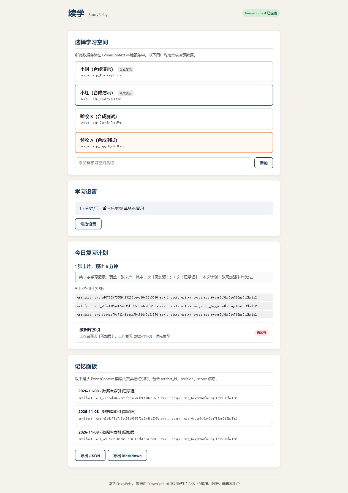

# Qoder 验收修正验证

验证时间：2026-11-08 19:50–19:51（Asia/Shanghai）。本次由 Codex 修正并执行，原有主要开发与 Qoder Sites 发布仍对应原真实 Qoder 会话。

## 修正内容

1. 集成测试默认端口从 8000 改为与应用/启动说明一致的 **18000**。无法连接真实服务时报错退出；不再静默跳过。每轮测试使用独立 Scope 幂等键，可重复执行。
2. Windows PowerShell 与 Bash 启动脚本在 PowerContext 提前退出、超时未就绪时以失败状态终止，保留日志并清理自有进程；不会继续启动应用。已运行的服务只复用、不停止。新增正整数 `PC_START_TIMEOUT`，默认 60 秒。Bash 文件固定 LF 换行。
3. 在 [SUBMISSION.md](../SUBMISSION.md) 中补入真实 Qoder UID、会话与三/四/五节材料索引；用户已同意 UID 随报名仓库交付。

## 实际执行

环境：Windows、Python 3.12、PowerContext **1.5.0**、FastAPI 0.162.2、Uvicorn 0.54.0、pytest 9.2.0。使用项目锁定依赖环境，PowerContext 使用其官方 SQLite 持久化实现；没有用自制 JSON/内存服务替代指定组件。服务端口为 18000/18080，数据目录为本次检出项目的 `.data/powercontext`，未上传数据库。

| 检查 | 结果 |
|---|---|
| 真实 `start.ps1` 自动启动 PowerContext 与应用 | 两次启动成功，`/health` 返回 PowerContext available=true |
| `python -m pytest -q` | **65 passed in 15.20s**，51 项原有单元测试 + 10 项脚本生命周期回归 + 4 项真实服务集成测试；0 跳过 |
| 同一真实服务上再次执行集成测试 | **4 passed in 3.98s**；无历史 Scope 冲突 |
| 指向不可达端口 19998 执行集成测试 | 退出码 1、4 errors，符合“缺失真实服务不得判通过”的预期 |
| 两种脚本的超时、服务提前退出、就绪、复用、应用失败 | 10 项受控外部命令回归通过；断言应用是否启动、失败是否传播及自有进程清理；不以这些受控回归冒充真实服务验收 |
| 真实业务种子流程 | 新建两个空间，12 次偏好更新后读取最新值；写入真实记忆引用；薄弱点优先；已掌握卡片延期；时间预算、空间隔离和请求去重通过 |
| 实际停止并重启应用与记忆服务 | 确认两个端口均已关闭后，重新执行启动脚本并从同一数据目录读取；偏好、自定义空间名称、薄弱点计划及去重均恢复 |
| 浏览器重启恢复检查 | 页面显示 15 分钟/天、保存的目标、3 条历史记录和真实 artifact/revision/scope |
| 无 Cookie/授权头访问 Qoder Sites | 首页、`development.html`、`assets/app-memory.jpg` 全部 HTTP 200，页面内容与本分支展示站相符 |

测试摘要：[ACCEPTANCE_FIX_TESTS.txt](ACCEPTANCE_FIX_TESTS.txt)。真实业务输入/响应与恢复结果：[ACCEPTANCE_FIX_LIVE.json](ACCEPTANCE_FIX_LIVE.json)。本次未修改展示站源码，线上展示内容无需重新发布。

## 复现

1. 按 [README](../README.md) 安装依赖、激活虚拟环境，在 `qoder` 目录运行 `start.ps1` 或 `start.sh`。慢机器可在启动前将 `PC_START_TIMEOUT` 设置为 120。
2. 新测试终端按 README 指定 `POWERCONTEXT_URL=http://127.0.0.1:18000`，执行单元测试与集成测试。Windows 如需跑 Bash 回归，设置 `STUDYRELAY_TEST_BASH` 指向 Git Bash 的 `bash.exe`。
3. 按 [VALIDATION.md](../VALIDATION.md) 输入偏好并完成复习；关闭应用与自建记忆服务进程，保留 `.data/powercontext` 后重新启动，核对偏好、记录、排程与 scope/artifact 引用。不可删除数据目录后再声称完成持久化验证。

## 提测表单差异

当前用户提供的表单没有 UID 或附件栏。已将 UID 和全部材料放在指定分支的 `qoder/SUBMISSION.md` 及相应文件中，供评审从提交 commit 核对；如主办方要求专用渠道，还需遵循其补交安排。此次检查不能替代主办方最终评分。
